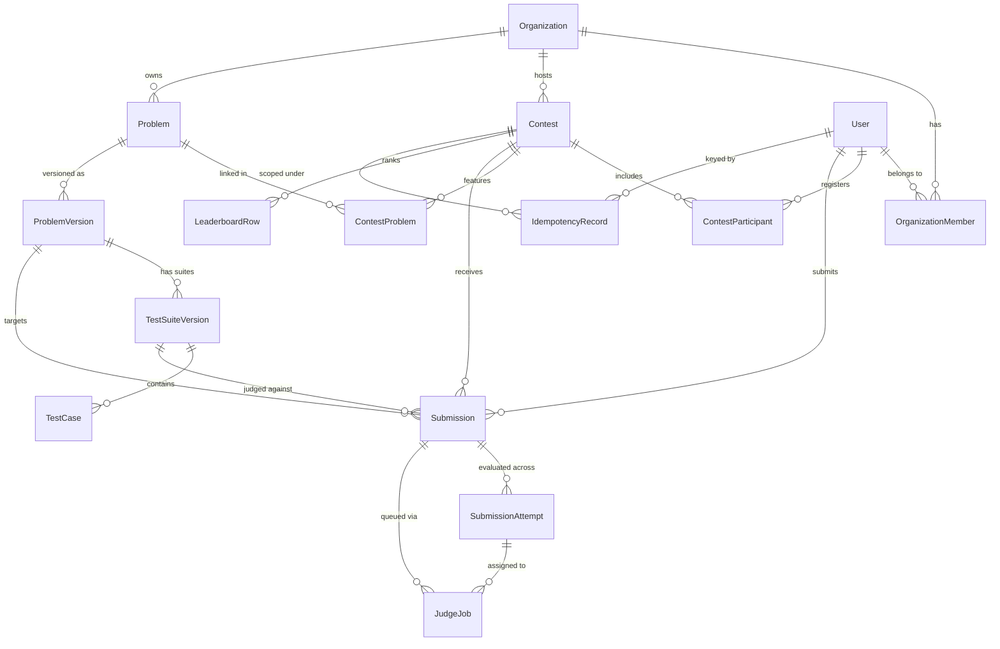

# Database Design & Consistency Architecture

## 1. Relational Schema Architecture

The relational schema is designed in PostgreSQL to provide strict transactional guarantees, historical auditability, zero data loss, and tenant isolation.

### Entity Relationship Diagram (ERD)



---

## 2. Immutable Versioning Pattern

### Problem & Test-Suite Immutability
A core requirement of contest platform engineering is that modifying a problem statement or test suite must **never silently mutate historical submission verdicts or standings**.

1. **`Problem`**: Represents the logical problem entity (e.g., Code `PROB-A`, Organization ID, Title).
2. **`ProblemVersion`**: Immutable snapshot of the problem statement, time limit, memory limit, and allowed runtimes.
   - Unique constraint: `@@unique([problemId, versionNumber])`
   - When an organizer edits a problem, a new `ProblemVersion` row with `versionNumber = N + 1` is inserted. Existing versions are never updated or deleted.
3. **`TestSuiteVersion`**: Immutable snapshot of test cases associated with a specific problem version.
   - Unique constraint: `@@unique([problemVersionId, versionNumber])`
4. **`Submission`**: Forever captures the specific `problemVersionId` and `testSuiteVersionId` that were authoritative at the time of submission.
   - Even if version 2 is published with tighter time limits, historical submissions retain their link to version 1.

---

## 3. Database Constraints & Indexes

### 3.1 Uniqueness Constraints
- `Organization.slug`: unique tenant identifier.
- `[organizationId, code]` on `Problem`: prevents code collisions within an organization.
- `[contestId, problemId]` and `[contestId, alias]` on `ContestProblem`: guarantees alias uniqueness (A, B, C) within a contest.
- `[contestId, userId]` on `ContestParticipant`: prevents duplicate registrations.
- `[idempotencyKey, actorId, contestId]` on `IdempotencyRecord`: guarantees idempotency per actor within a contest.
- `[submissionId, attemptNumber]` on `SubmissionAttempt`: strictly orders judging attempts.
- `[contestId, userId]` on `LeaderboardRow`: ensures exactly one standings row per participant.

### 3.2 Indexing Strategy
- **Worker Claiming Index**: `CREATE INDEX idx_judge_job_claim ON "JudgeJob" ("status", "leaseExpiresAt");`
  - Optimizes `FOR UPDATE SKIP LOCKED` query when workers poll for queued or expired jobs.
- **Leaderboard Performance Index**: `CREATE INDEX idx_leaderboard_perf ON "LeaderboardRow" ("contestId", "score" DESC, "penaltyTimeSec" ASC);`
  - Transforms full table scans into an index scan, eliminating CPU-heavy in-memory sort operations during high-frequency leaderboard reads.
- **Tenant Isolation Indexes**: Indexes on `organizationId` across `Problem`, `Contest`, and `OrganizationMember` to accelerate authorization checks.
- **Participant Access Index**: `CREATE INDEX idx_submission_user ON "Submission" ("contestId", "userId");`
  - Guarantees fast retrieval when participants fetch their own submission history.

---

## 4. Transactional Outbox Pattern

To eliminate the classic distributed systems failure where a submission is committed to the database but the process crashes before dispatching the asynchronous job, Shodh a Code uses a **PostgreSQL Transactional Outbox**:

```sql
BEGIN;
  INSERT INTO "Submission" (...) VALUES (...);
  INSERT INTO "SubmissionAttempt" (...) VALUES (...);
  INSERT INTO "JudgeJob" (status: 'QUEUED', priority: 0) VALUES (...);
  INSERT INTO "OutboxEvent" (status: 'PENDING', aggregateType: 'SUBMISSION', ...) VALUES (...);
  INSERT INTO "IdempotencyRecord" (...) VALUES (...);
COMMIT;
```

Because the submission record, initial attempt, judge job, and outbox event are committed in the same database transaction, atomicity is guaranteed by PostgreSQL's Write-Ahead Log (WAL). If the API node crashes immediately after committing, the job remains safely queued in PostgreSQL and is claimed by workers without data loss.
